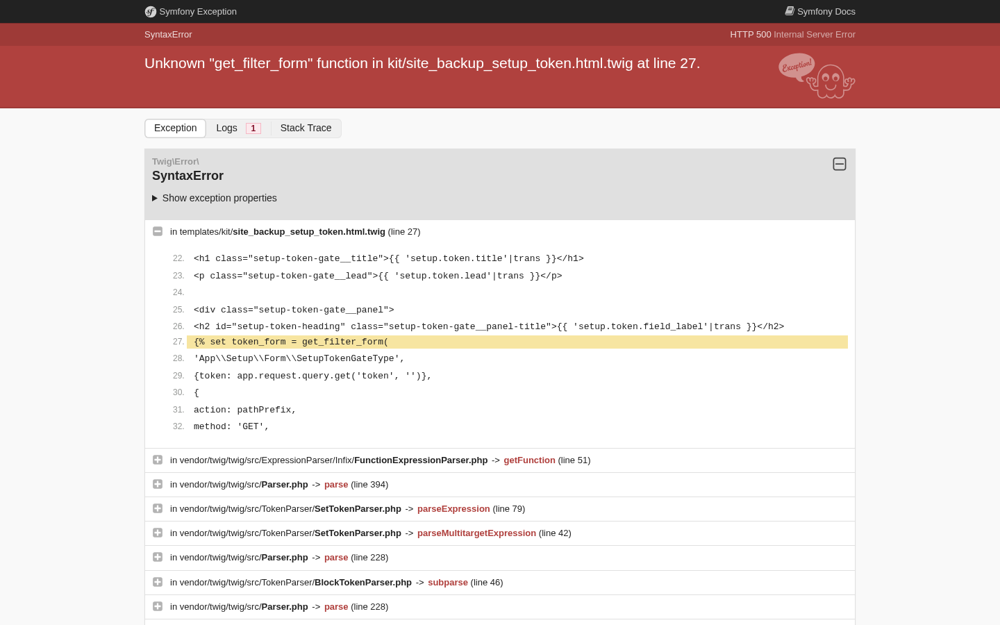
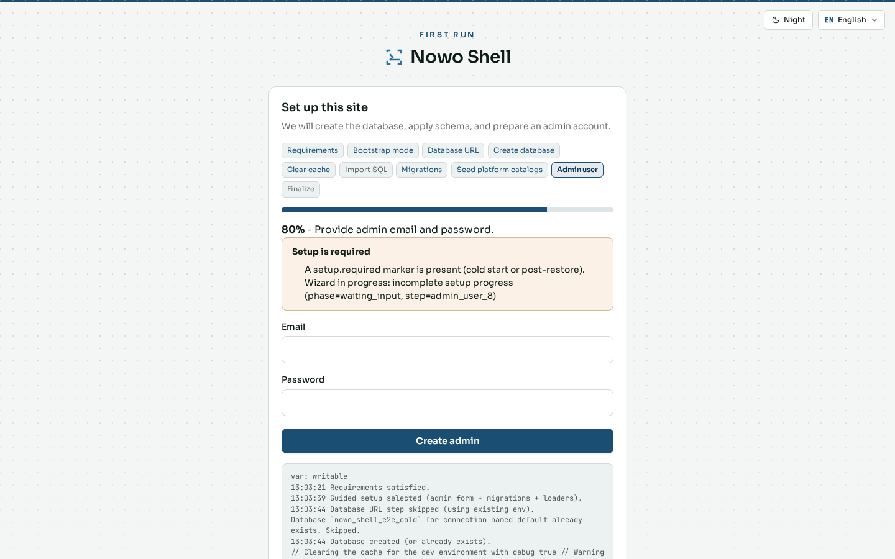
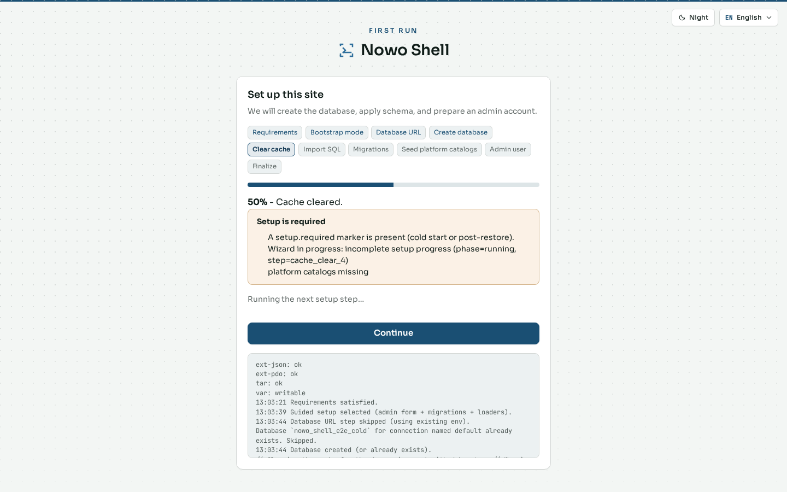
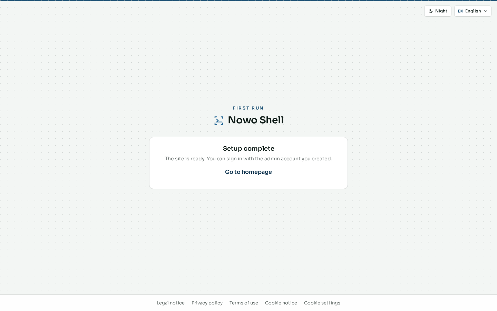

# First-time setup

A new Shell instance is bootstrapped with the SiteBackup **setup wizard**. Until setup finishes, AuthKit routes such as `/login` and `/register` redirect into setup (the setup token is not exposed on those redirects).

> **Safety:** Wizard screenshots use a disposable cold stack (`make wipe-e2e-cold`). Never advance `/setup/api/*` against dogfood or warm `nowo_shell_e2e`.

This chapter shows the gate visitors hit before setup, then the guided **fresh install** path that creates schema, seeds platform catalogs, and the first admin account.

## Auth gate

**What it is.** When setup is still required, opening `/login` lands on the setup gate instead of the normal sign-in form.

**What it contributes.** It tells operators that the instance is not ready for AuthKit yet, and points them to complete setup with a local token rather than guessing credentials.

## Wizard — entry and boot mode

Open the wizard with the local setup token (`SITE_SETUP_TOKEN` / default E2E `app-local-setup`):

`/setup?token=…`

**What it is.** A stepped assistant that checks requirements, chooses how to boot (guided migrations vs full SQL dump), then runs database and platform work through to completion.

**What it contributes.** One place to decide fresh install vs restore, keep progress visible, and avoid hand-running migrations on a cold box.

Typical **fresh install** sequence:

1. Choose profile / bootstrap mode  
2. Optional database URL (Compose `DATABASE_URL` when skipped)  
3. Migrations and platform seed  
4. Create the first **admin** account  
5. Optional sample data  
6. Completion → sign in  

## Wizard — migrations in progress

**What it is.** A mid-flow status step while schema migrations (and related platform jobs) run.

**What it contributes.** Confirms that the database is being prepared; operators should wait for this step to finish before treating the instance as usable.

## Wizard — first admin account

**What it is.** The form that creates the initial administrator (email, password, display name).

**What it contributes.** Establishes the first `ROLE_ADMIN` account so you can sign in after setup. On restore-from-dump flows this step may be skipped when users already exist in the dump.

## Wizard — completion

**What it is.** The done screen after setup completes successfully.

**What it contributes.** Confirms the instance is ready for AuthKit sign-in and points operators to the dashboard.

## Next steps

- [Getting started](01-getting-started.md) — sign in with the admin you created  
- [Administration](04-admin.md) — manage users and instance settings after bootstrap  
