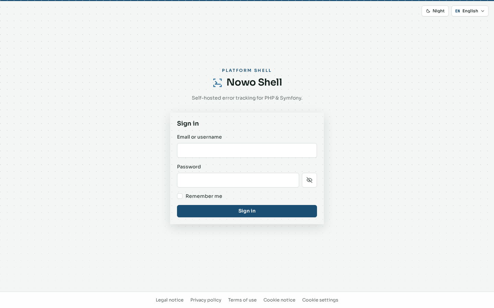

# Getting started

Authentication uses **AuthKit** (`nowo-tech/auth-kit-bundle`). On a fresh install, registration is **first-user-only**; seeded demos already include an admin, so `/register` redirects to login.

Screenshots below are **English + day**. To switch theme or language, see [Theme and language](06-appearance.md).

This chapter covers the public AuthKit entry points that ship **enabled** on the warm stack: password sign-in, password reset, and magic link. QR / phone sign-in stays **disabled** until phone OTP is wired.

## Sign in

**Route:** `/login`

**What it is.** The primary credential form (email or username + password), with “Remember me” and links to alternate sign-in methods.

**What it contributes.** Secure access to the private UI. Footer links expose legal pages and cookie settings without requiring a session.

A successful sign-in opens the [dashboard](02-dashboard.md).

## Registration (first user only)

**Route:** `/register` (only when no users exist yet)

**What it is.** The registration form for creating the first `ROLE_ADMIN` under AuthKit `first_user_only` rules.

**What it contributes.** Cold bootstrap without the CLI. On seeded or production instances with existing users, registration redirects to login — that is expected. Prefer the [setup wizard](00-setup.md) admin step on empty installs; afterwards create users under [Administration](04-admin.md).

## Reset password

**Route:** `/reset-password`

**What it is.** The recovery form that starts an email-based password reset when `password_reset.mode: enabled` is active for the AuthKit profile.

**What it contributes.** Self-service account recovery. Mail delivery depends on the instance mailer (local stacks often use Mailpit). When the feature gate is off, `/reset-password` redirects to Sign in — no separate screenshot is kept (same rule as QR).

## Magic link

**Route:** `/login/magic`

**What it is.** Passwordless sign-in: the user requests a one-time link sent by email when `magic_login.mode: enabled` is active.

**What it contributes.** Convenient access when password entry is inconvenient, while still relying on mailbox ownership. Requires a working mailer. When the feature gate is off, `/login/magic` redirects to Sign in — no separate screenshot is kept (same rule as QR).

## QR (phone) sign-in (disabled)

**Route:** `/login/qr`

Shell starters keep `qr_login.mode: disabled` until phone OTP is ready. Enable it in `config/packages/nowo_auth_kit.yaml` (and a prod overlay when product E2E needs base `enabled`) before documenting a QR screenshot here.

## Next steps

- [Dashboard](02-dashboard.md) — authenticated home after sign-in  
- [Account](03-account.md) — profile, security, and privacy tools  
- [Legal pages](05-legal-and-privacy.md) — public legal and cookie copy  
