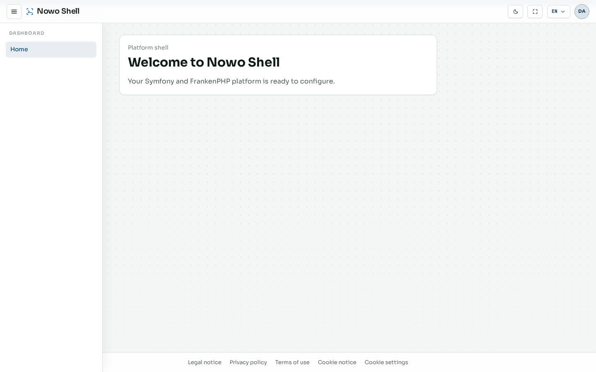

# Dashboard

After sign-in, the dashboard is the authenticated home for the Shell platform starter. It orients operators toward account settings and administration rather than product-specific domains (those live in apps built on Shell, such as Beacon).

Theme comparison for this private surface: [Theme and language](06-appearance.md#private-example-dashboard).

## Home

**Route:** `/dashboard`

**What it is.** The signed-in landing page with navigation into Account, Administration, and platform health context.

**What it contributes.** A stable entry point after AuthKit login. From here you reach identity tools, instance settings, and kit admin panels without memorizing routes.

## Next steps

- [Account](03-account.md) — profile, security, display, and privacy  
- [Administration](04-admin.md) — users, RBAC, settings, and kits  
