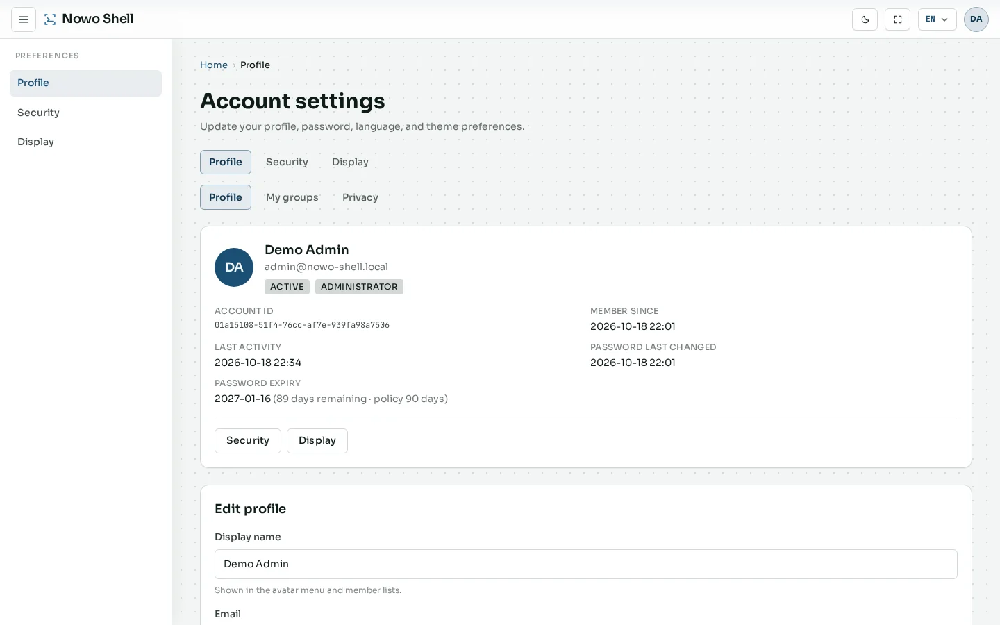
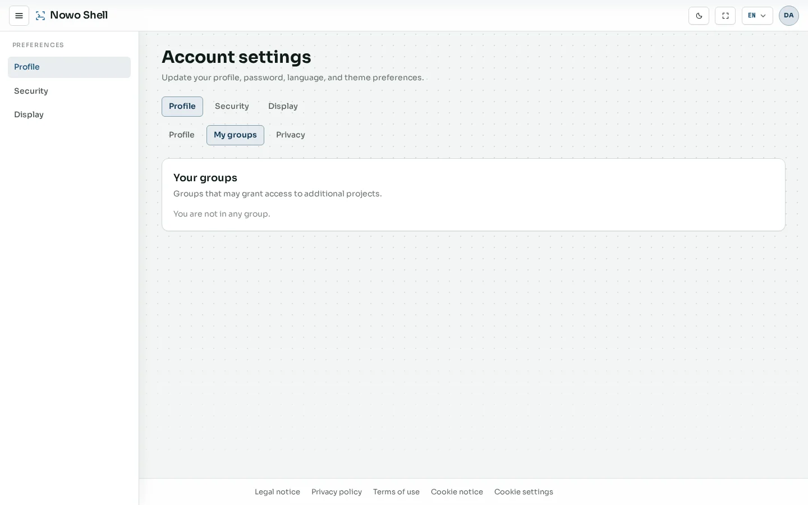
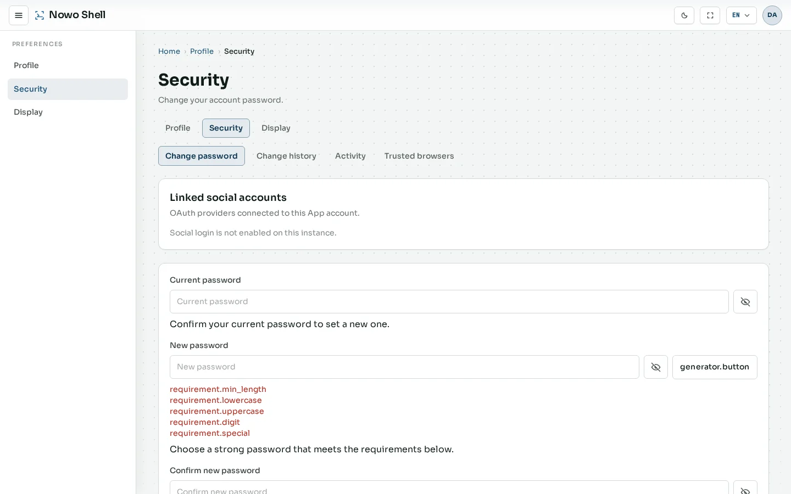
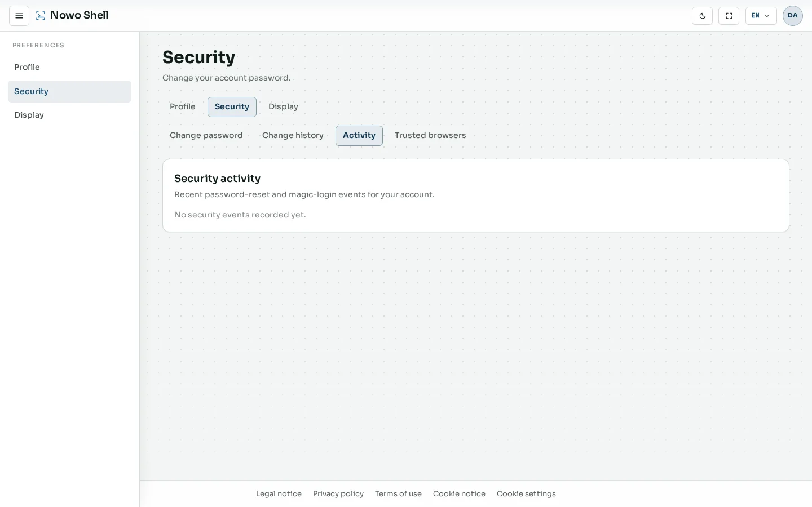
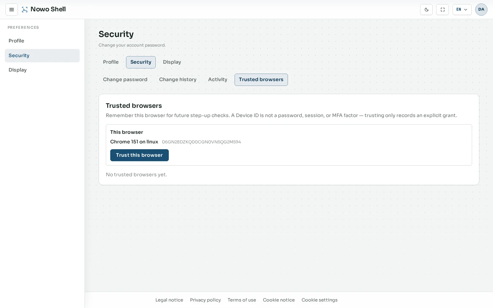
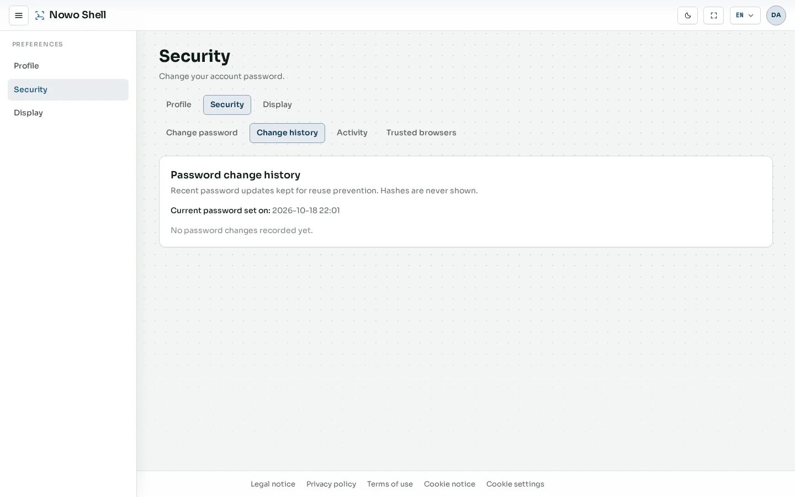
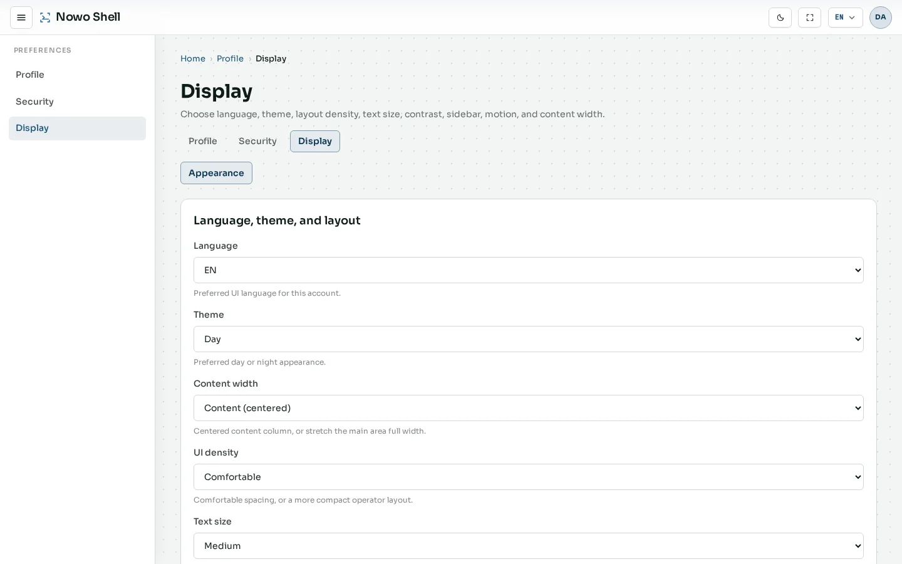
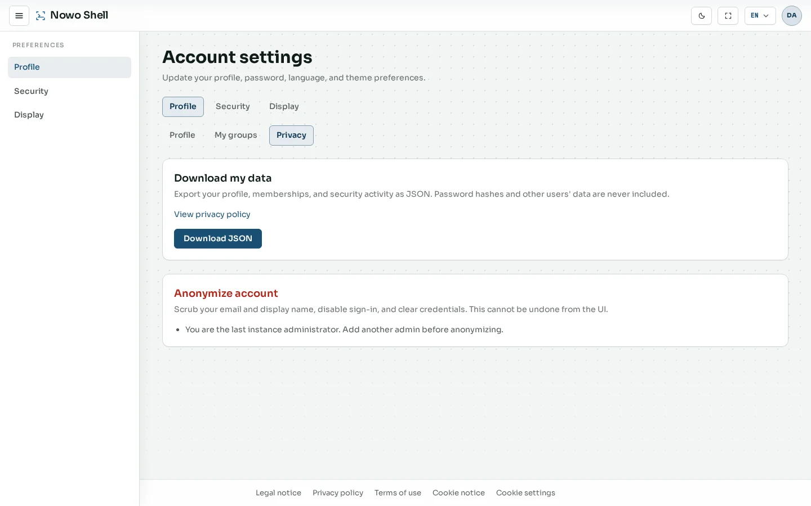

# Account

Signed-in preferences live under **Account settings** (UserKit + AuthKit): profile identity, memberships, security, display, and privacy tools.

Open Account from the avatar menu in the header. Sidebar groups: **Profile**, **Security**, and **Display**. Profile also hosts **Groups** and **Privacy** sub-tabs.

## Overview

**Route:** `/account` or `/account/profile`

**What it is.** The Profile landing view: account card (status, roles, membership metadata) plus editable identity fields such as display name and phone.

**What it contributes.** Confirms who you are signed in as, password-policy status, and shortcuts into Security / Display. Phone verification supports QR login (see [Getting started](01-getting-started.md#qr-phone-sign-in)).

## Profile {#profile}

**Route:** `/account/profile`

**What it is.** The editable profile section (display name, phone, related identity fields).

**What it contributes.** Controls how your name appears in member lists and the avatar menu, and keeps phone state aligned with QR sign-in.

## Groups

**Route:** `/account/groups`

**What it is.** Groups your account belongs to (groups are used for access grants in product apps).

**What it contributes.** Explains group memberships managed by administrators under [Administration → Groups](04-admin.md#groups).

## Security

**Route:** `/account/security`

**What it is.** Password change and security settings for the account.

**What it contributes.** Self-service credential hygiene without admin intervention. Complements instance-wide password policy from the password kits.

### Security activity

**Route:** `/account/security/activity`

**What it is.** Recent security-relevant events for your account (sign-ins and related activity).

**What it contributes.** Personal audit trail so you can spot unexpected access.

### Trusted devices

**Route:** `/account/security/devices`

**What it is.** Devices marked as trusted for reduced friction on repeat sign-ins.

**What it contributes.** Lets you review and manage remembered devices tied to AuthKit sessions.

### Password history

**Route:** `/account/security/history`

**What it is.** History of password changes for the account.

**What it contributes.** Supports compliance and personal hygiene when password reuse is restricted.

## Display

**Route:** `/account/display`

**What it is.** Personal UI preferences: theme, density, motion, font scale, and related display options.

**What it contributes.** Per-user comfort settings that sync with the header theme toggle (see [Theme and language](06-appearance.md)).

## Privacy

**Route:** `/account/privacy`

**What it is.** GDPR-oriented self-service: export personal data and request anonymization where policy allows.

**What it contributes.** Complements public [Legal → Privacy policy](05-legal-and-privacy.md#privacy-policy) with signed-in data-subject tools.

## Next steps

- [Administration](04-admin.md) — operator tools (requires `ROLE_ADMIN`)  
- [Theme and language](06-appearance.md) — header controls for day/night and locale  
