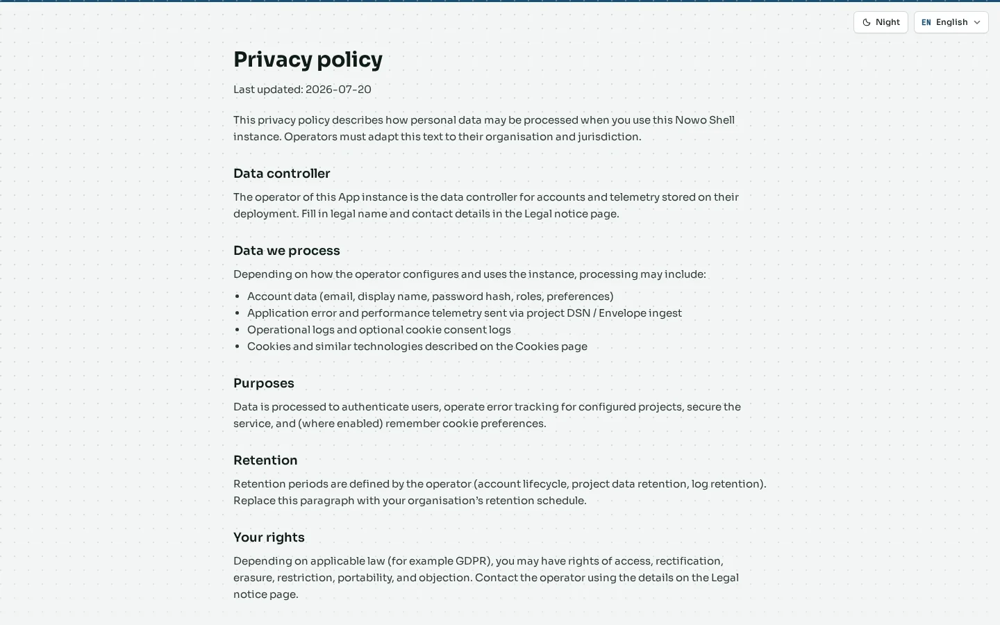
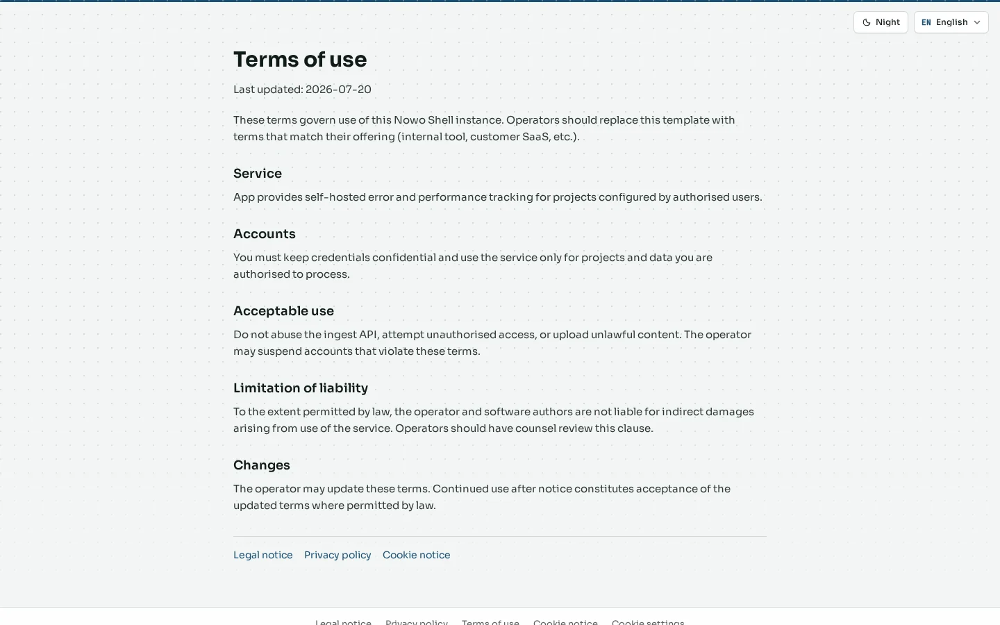
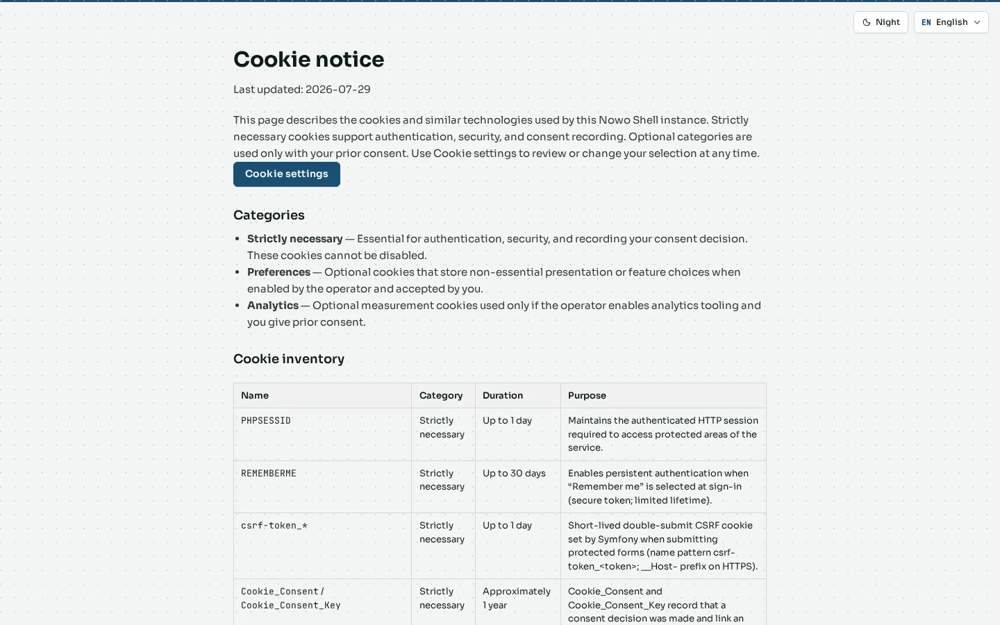

# Legal and privacy

Public legal pages and cookie consent. Screenshots are **English + day**. Theme and language switching is covered once in [Theme and language](06-appearance.md).

## Privacy policy

**Route:** `/en/legal/privacy`

**What it is.** The privacy policy for the instance (CookieConsent / SiteBackup legal catalog).

**What it contributes.** Transparency for data processing; linked from AuthKit footers and the cookie banner.

## Terms of use

**Route:** `/en/legal/terms`

**What it is.** Terms of use for the instance.

**What it contributes.** Contractual baseline for operators and end users without inventing a custom legal CMS.

## Cookies

**Route:** `/en/legal/cookies` (when published in the catalog)

**What it is.** Cookie inventory / policy page paired with CookieConsent.

**What it contributes.** Explains which cookies are functional vs optional; the live banner still drives consent choices.

